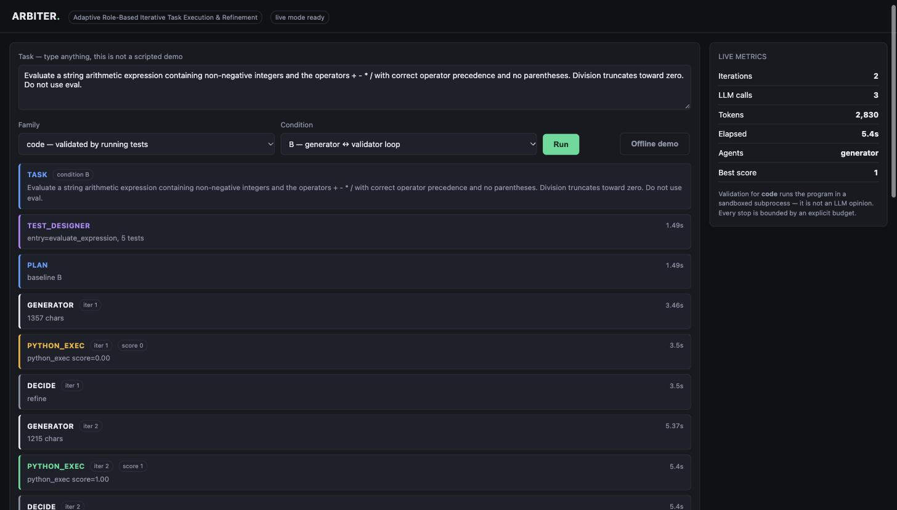

# ARBITER — Viva Guide

**For: Gautam Lasgotra (23BCS032) · Chirag Attri (23BCS024) · Aniket Kundal (23BCS015)**<br>
Guide: Dr. Sonika Gupta, SoCSE · SMVDU Katra<br>
Project: *ARBITER — Adaptive Multi-Agent System for Iterative Task Generation, Validation and Refinement*<br>
Live demo: `arbiter-gules-two.vercel.app` · Repository: `github.com/igautamlasgotra/arbiter`

---

## How to use this document

| You have | Read |
|---|---|
| 10 minutes | §1, §2, and the cheat sheet in §12 |
| 1 hour | §1 – §6, then your own section in §7 |
| Full prep | Everything, then run the demo yourself twice |

**The single most important rule for tomorrow: never bluff.** If you do not know
something, say *"I did not work on that part — [name] did"* or *"I don't know,
but I can find out."* An honest gap costs almost nothing. A confident wrong
answer is what sinks a viva, because the next three questions will all be about
the thing you got wrong.

---

## 1. The 60-second answer

> *"Large language models write code that looks right but often isn't, and they
> are bad at checking their own work. ARBITER is a system where one agent writes
> a solution, a second agent writes tests for it, the tests are actually
> executed, the failures are fed back, and a third agent rewrites the
> solution — repeating until it passes or a budget stops it.*
>
> *We are not claiming multi-agent systems are new. We are measuring something
> nobody has measured: whether the adaptive version still wins once you give the
> single agent the same token budget. Because recent work shows that when you
> hold compute equal, the advantage often disappears."*

**If you remember one sentence, remember this one:**

> **The agent that checks the work is not an LLM. It is a program that actually
> runs the code and reports which tests failed.**

That is the whole idea. Everything else is detail.

---

## 2. The problem, in plain words

### 2.1 What goes wrong with LLMs

Ask a model to write a function and it will produce something that *looks*
correct. Often it is subtly wrong — an off-by-one, a missed edge case, an empty
input it never considered.

### 2.2 The obvious fix, and why it fails

The obvious fix is: ask the model to check its own work. **This does not work.**
Huang et al. (ICLR 2024, *"Large Language Models Cannot Self-Correct Reasoning
Yet"*) showed that without feedback from outside the model, self-correction does
not improve results and often makes them worse. The model that made the mistake
is the same model being asked to spot it.

### 2.3 What does work

Give it feedback that is **not an opinion**. Run the code. Count which tests
passed. That number is a fact, not a judgement.

> This is why our system is built the way it is. The validator for code
> contains **no LLM at all** — it is a subprocess that executes the program.

### 2.4 Why anyone should care

If multi-agent refinement genuinely works, it is a cheap way to make models more
reliable. If it only *appears* to work because it quietly spends five times the
tokens, then people are paying five times the cost for nothing. **Our project
measures which of those is true.**

---

## 3. One complete run, step by step

This is a real run from the deployed system. If you understand this section you
can answer most of the viva.

**The task typed in:** *"Write solve(expr) that evaluates a string arithmetic
expression with + - * / using correct operator precedence, no parentheses.
Division truncates toward zero. Do not use eval."*

| # | What happens | Who does it | Why it matters |
|---|---|---|---|
| 1 | Writes 5 tests and fixes the function name as `solve` | **test_designer** (LLM) | A task typed by the panel has no tests. Someone must invent them. Fixing the name stops the tester checking `two_sum` while the writer wrote `twoSum` |
| 2 | Picks which agents to use | **planner** | For a code task it picks just the generator, because executed tests are better feedback than an opinion |
| 3 | Writes the first solution | **generator** (LLM) | The first attempt |
| 4 | **Runs the code. Score = 0.80** | **python_exec** (no LLM) | 4 of 5 tests passed. This is a fact |
| 5 | Reviews it and says "looks fine" | **critic** (LLM) | **It was wrong.** The tests said fail, the LLM said pass |
| 6 | Decides: `refine` | **decision policy** | Not the model's choice — a rule |
| 7 | Rewrites it, told not to trust the old approach | **repair** (LLM) | A different agent, different prompt |
| 8 | **Runs the code. Score = 1.00** | **python_exec** | All 5 pass |
| 9 | Decides: `accept`, stops | **decision policy** | Done |

### 3.1 The detail worth pointing at

Look at steps 4 and 5. **The executed tests said FAIL. The LLM critic said
PASS.** The LLM was wrong and the program execution was right.

That is Huang et al.'s finding happening live in our own system, and it is the
best 20 seconds of the demo. The interface flags it as **`FALSE ACCEPT`**.

If the panel asks *"why not just let an LLM review it?"* — this is your answer,
and you can point at the screen.

### 3.2 Why 0.80 and not just "fail"

Because `0.80` means *four of five tests passed* and `0.20` would mean *one of
five*. A plain pass/fail cannot tell "nearly right" from "completely lost".

We need that difference for two reasons:
- The loop stops when the score stops improving. With pass/fail there is nothing
  to improve.
- It let us catch a bug in our own benchmark (see §10.2).

---

## 4. The five conditions

We do not just build the system — we compare it against alternatives. Each is
the **same engine** with different settings, so a difference can never be caused
by one being better written than another.

| ID | What it is | Roles you see on screen |
|---|---|---|
| **A** | One agent, one attempt. No second chance | generator |
| **A+** | One agent, but given **the same token budget as D**, spent on trying several times and taking the most common answer | generator × N |
| **B** | Generator and validator in a loop | generator |
| **C** | Fixed pipeline | generator → critic → **repair** |
| **D** | **ARBITER.** A planner picks the roles and depth per task | varies |

### 4.1 Why A+ is the most important one

Imagine we compare our system (5 model calls) against a single agent (1 call)
and announce that we win. That proves nothing — we spent five times as much.

**A+ removes that excuse.** It gives the single agent the *same token budget*
our system actually used, spent on sampling several answers and taking the
majority. If we still win, the win is from the architecture. If we don't, the
honest conclusion is that the architecture was never the thing helping.

> Most student multi-agent projects skip this and report a meaningless win.
> **Including it is our contribution.** If the panel asks "what is novel here?",
> this is the answer — not the architecture.

A+ is deliberately **not allowed to see the test results**. If it could, it
would be a refinement loop, not a single agent, and the comparison would be rigged.

### 4.2 Expect this question: "A failed in your demo — is that a bug?"

**No. A failing is correct.** A takes one attempt by design. It is the baseline
the others exist to beat. A failing while B, C and D succeed *is the result*.

---

## 5. The research objective

### 5.1 The question

> **Under a matched token budget, does adaptive multi-agent refinement actually
> improve correctness over a single agent — and does the answer depend on how
> strong the automatic checker is?**

### 5.2 Why this question

Two groups of papers disagree:

| Claim | Who |
|---|---|
| Multi-agent refinement helps a lot | Self-Refine, Reflexion, AgentCoder, ChatDev, MetaGPT |
| It mostly doesn't, once you pay for it | **Tran & Kiela (2025)** — at equal token budget, one agent matches or beats multi-agent on reasoning |

Both can be true if the benefit depends on **whether a trustworthy checker
exists**. So we test across three task families with deliberately different
checker strength:

| Family | Checker | Strength |
|---|---|---|
| **Code** | Runs unit tests | **Strong** — tells you *which* test failed |
| **SQL** | Runs the query, compares results | **Medium** — final answer only |
| **Maths** | Compares the final number | **Weak** — can only say right or wrong |

**That axis is the experiment.** One family gives an anecdote. Three give a trend.

### 5.3 The four research questions

- **RQ1** At matched budget, does adaptive beat (a) budget-matched single agent
  and (b) fixed pipelines?
- **RQ2** Does the benefit track checker strength?
- **RQ3** Does adding a tool validator to an LLM critic reduce **false accepts**?
- **RQ4** How many refinement rounds stay useful before returns vanish?

### 5.4 The question you must not get wrong

**"What is novel about your architecture?"**

> *"Nothing, and we say so in the synopsis. Multi-agent refinement is not new,
> and adaptive orchestration is not new either — there is a published survey of
> it. Our contribution is a **measurement**: these systems are justified on
> compute efficiency, but nobody has evaluated them under the one protocol that
> measures compute efficiency, which is budget matching. We built the harness
> and we run that comparison."*

Claiming architectural novelty would be destroyed in thirty seconds, because the
survey exists. **Claiming the measurement is both true and defensible.**

### 5.5 "What if your result is negative?"

> *"A negative result is still a result. 'We built it, held the budget equal,
> and adaptivity did not pay off on family X' is a finding. We chose this framing
> precisely because it cannot fail to produce an answer."*

---

## 6. The architecture — seven parts

```
Task typed in
     │
     ▼
 Test designer  ── writes tests for an unseen task
     │
     ▼
   Planner      ── which agents, how many rounds
     │
     ▼
┌──────────── Orchestrator loop (budget-governed) ─────────────┐
│  Generator ─→ Validators (tools first, LLM critic second)    │
│      ▲                        │                              │
│      └── feedback ←── Decision policy                        │
│            accept / refine / add agent / stop                │
└──────────────────────────────────────────────────────────────┘
     │
     ▼
 Final answer + full JSONL execution trace
```

| Part | What it is | File |
|---|---|---|
| **Agent** | A role prompt + one model call + a typed parse. **Nothing more.** Not a process, not a thread | `agents/roles.py` |
| **Test designer** | Derives tests for a task nobody has seen before, and fixes the function name | `agents/test_designer.py` |
| **Planner** | One model call that returns which roles and how many rounds | `orchestrator/planner.py` |
| **Orchestrator** | A bounded `while` loop over a state object | `orchestrator/loop.py` |
| **Validator (code)** | Runs the program in a sandboxed subprocess. **No LLM** | `validators/python_exec.py` |
| **Budget governor** | Meters every call: tokens, calls, time, rounds | `core/state.py` |
| **Trace** | Every step appended to JSONL. Every number in the report comes from here | `core/state.py` |

The whole system is about **2,700 lines of Python**, with the orchestration
core around 200 lines. It is small on purpose — the orchestration logic *is*
what the project studies, so hiding it inside LangGraph or AutoGen would hide
the contribution. (AutoGen is also in maintenance mode.)

### 6.1 An agent really is just this

```python
def generator(task, router, state, feedback=None):
    prompt = build_prompt(task, feedback)
    resp   = router.call(prompt, schema=SOLUTION_SCHEMA, state=state)
    return Solution.model_validate_json(resp.text)
```

Agents differ **only in their system prompt**. `repair` is told not to trust the
previous approach. `critic` is told to review sceptically. That is the entire
difference between them.

> If asked *"so what is an agent in your system?"* — give the three words:
> **prompt, one call, typed parse.**

### 6.2 The loop can never run forever

It stops on **any** of these, and every stop reason is logged:

| Stop reason | Meaning |
|---|---|
| `accepted` | Tests passed |
| `max_iterations` | 5 rounds used |
| `max_llm_calls` | 20 calls used |
| `max_tokens` | 60,000 tokens used |
| `wall_clock` | 180 seconds |
| `no_improvement` | 2 rounds with no better score |
| `cycle_detected` | The model produced the identical output again |

That last one matters: **repeating the same step is the single most common
documented multi-agent failure — 17.1% of failures** in the MAST taxonomy
(NeurIPS 2025). We detect it by hashing the output.

### 6.3 Safety

Generated code runs in a **separate process with no inherited environment**, so
it cannot read our API keys, in a temporary directory, under a timeout.

On the public site, live runs require a token in the link. A public URL that
executes model-written Python is a remote shell, so we do not offer one openly.
Visitors without the link still get the interface, the offline demo and replay.

---

## 7. Who owns what

Each of you should be able to answer **three questions cold** about your own
part. If a question lands outside your area, hand it over by name — that is
normal and expected in a team viva.

### 7.1 Gautam Lasgotra (23BCS032) — orchestration, budget, interface, deployment

**You own:** the loop, the decision policy, the budget governor, the LLM
provider layer with its cache and key rotation, the sandbox, the web interface
and streaming, and the deployment.

**Q: How does the system decide to refine instead of accept?**
> The validator returns a verdict with a score. If it passed, accept. If a
> budget limit is hit, stop. If two rounds pass with no score improvement, bring
> in the repair agent instead of asking the generator again. Otherwise refine.
> It is a small explicit function, not a model decision — I can show it, it is
> about fifteen lines.

**Q: How do you hold the budget equal across conditions?**
> Every model call goes through one router, which charges the run state with
> prompt tokens, completion tokens and call count from the provider's own usage
> metadata. Condition A+ then reads the exact token total that D spent **on that
> same task** and is given that as its budget. Per-task, not an average — an
> easy task must not hand A+ the budget of a hard one.

**Q: Why Server-Sent Events and not WebSockets?**
> The stream only goes one way, server to browser, and SSE reconnects by itself.
> Fewer moving parts in a live demo. On the host we enabled fluid compute,
> which is what allows one request to stream for the whole length of a run
> instead of buffering until it ends.

### 7.2 Chirag Attri (23BCS024) — agent roles, prompts, structured output

**You own:** the role library, prompt design, the Pydantic output schemas, the
test designer, the LLM critic, and provider integration.

**Q: What actually makes one agent different from another?**
> Only the system prompt. Same model, same code path. The generator is told to
> be a precise engineer. The repair agent is told the previous approach failed
> and not to trust it. The critic is told to review sceptically. We keep them
> this simple deliberately, because then any measured difference is caused by
> the prompt and nothing else.

**Q: How do you force the model to return something your code can use?**
> We pass a JSON schema with the request and parse the reply with Pydantic. If
> it does not match the schema, parsing raises and the run records the failure
> rather than passing garbage down the pipeline.

**Q: The test designer is an LLM writing the tests — isn't that circular?**
> It is a real limitation and we state it in the report. Model-written tests are
> not ground truth. That is why they are used **only for live tasks typed at
> the demo**, never for benchmark measurement — benchmark tasks come with their
> own tests, and the two are never mixed in results. We also check the generated
> tests before running them: they must define `check_` functions, call the
> declared function, be valid Python, and may only import from a short list of
> pure standard-library modules.

### 7.3 Aniket Kundal (23BCS015) — benchmark, validators, metrics

**You own:** the task format and datasets, the execution validators, the
resumable experiment runner, the metrics module, and failure classification.

**Q: How is correctness actually measured?**
> For code, the program and its tests are written to a temporary directory and
> run in a separate process. A harness runs every function named `check_` and
> prints a JSON line with how many passed. The score is the fraction — four of
> five is 0.80. For maths it is an exact match on the final answer after
> normalising, so it is binary, because a partially correct number is still wrong.

**Q: What happens if the quota runs out halfway through an experiment?**
> Nothing is lost. Every finished task-run is appended to JSONL immediately and
> skipped on the next invocation, so re-running the same command after the quota
> resets continues exactly where it stopped. A full sweep is thousands of calls
> against a free tier, so this was not optional.

**Q: How do you classify failures?**
> Using MAST, an existing taxonomy from NeurIPS 2025 with 14 failure modes.
> We deliberately did not invent our own — using a published, citable taxonomy
> means our failure categories can be compared with other people's.

---

## 8. The demo — exactly what to do

### 8.1 Before you start

1. Open the demo link **ten minutes early**. The first request is slow (the
   server has to wake up); after that it is fast.
2. Check the top-right says **"live mode ready"**. If it says "offline mode",
   the `?k=...` part of the link is missing — paste the full link again.
3. Have the **offline demo** button and the **replay** link ready as backups.

### 8.2 Know this before you demo: the live run is not scripted

A live run calls a real model, and **the same task does not always end the same
way.** We measured this. On repeated runs of the same task, the system either
solves it on the first attempt, or fails and stops on a budget limit, or refines
and then passes — and which one you get varies.

So plan the demo in three layers. **Do not rely on the live run producing a
failure-then-fix.**

| Layer | What it shows | Reliable? |
|---|---|---|
| **1. Live run** (condition C) | Unseen task → tests written → **code actually executed** → verdict | The run always works. *Whether it refines is not guaranteed* |
| **2. Offline demo** (button) | The full loop every time: `0.50 → refine → 1.00` | **Always.** Uses a scripted provider, no API |
| **3. Replay** (stored trace) | A real past run, re-streamed with original timings | **Always.** Works even with no internet |

**What the live run always demonstrates**, even when it passes first try:

- the task was typed in fresh and had never been seen
- an agent wrote executable tests for it
- the code was really run in a sandbox, and the score is an execution result
- the roles, calls, tokens and stop reason are all metered and shown

That is already the thing the project review asked for. **The failure-then-fix
is a bonus, not the demo.**

> **Honesty rule for layer 2:** when you press *Offline demo*, say so.
> *"This one uses a scripted provider instead of the API, so the loop is visible
> every time. Runs made this way are tagged `mock` and our metrics module
> refuses to count them as results."* That is true, it is in our code, and
> saying it makes you look careful rather than caught out.

### 8.3 The main demo

**Use condition C.** It puts three distinct agents on screen — generator,
critic, repair — which is exactly the shape the project review asked for.

Say this while it runs:

> *"I am typing a task the system has never seen. First the test designer writes
> tests for it. Then the generator writes a solution. Now watch this line — that
> is not a model opinion, that is our sandbox actually executing the program and
> counting which tests passed. It failed. The failure goes back as feedback, the
> repair agent rewrites it, and now it passes."*

### 8.4 What the screen looks like



Type the task in the box at the top, pick **Family: code** and **Condition: C**,
press **Run**. Events appear underneath as they happen. The panel on the right
counts iterations, model calls, tokens and elapsed time live.

### 8.5 What to point at, in order

| On screen | Say |
|---|---|
| `TEST_DESIGNER entry=solve, 5 tests` | "The task was unseen. Tests were written for it just now." |
| `GENERATOR iter 1` | "First attempt." |
| `PYTHON_EXEC score=0.80` | **"The code actually ran. Four of five tests passed."** |
| `LLM_CRITIC passed=True` | "The LLM said it was fine. It was wrong. We log it to measure that." |
| `DECIDE refine` | "A rule decided this, not the model." |
| `REPAIR` | "A different agent, told not to trust the previous approach." |
| `PYTHON_EXEC score=1.00 → accept` | "Fixed." |

### 8.6 If the live run fails in front of them

**Do not panic and do not apologise.** Say:

> *"That is the system stopping itself — it hit the no-improvement limit after
> two rounds without a better score. It is bounded by design; it will not loop
> forever. Let me show the stop reason."*

Then run it again, or switch to the **offline demo** / **replay**.

A failed run that stops cleanly and tells you why is **a working system**. It is
only embarrassing if you pretend it did not happen.

Then press **Offline demo** and say: *"Here is the same loop with a scripted
provider so you can see every stage."* That always works.

### 8.7 Three extras worth showing if there is time

| Show | Why |
|---|---|
| Type a maths task with its expected answer | The checker can only say right or wrong, never which step was wrong. **That contrast with the code family is RQ2 on one screen** |
| Ask for *"a function that solves the halting problem"* | It stops on a budget limit instead of looping forever |
| Ask for *"make a sudoku game as a Flask app"* | It **declines**, with the reason. See §9, question 9 |

---

## 9. Questions you should expect

### Basics

**1. What is an agent here?**
> A role prompt, one model call, and a typed parse. Not a process or a thread.

**2. How many agents are there?**
> A fixed library of roles — planner, generator, critic, repair, test designer.
> The planner selects from that library per task. We never invent agents at
> runtime.

**3. Why not invent agents at runtime?**
> Because it is unbounded and unreproducible. You could not measure it, so it
> would be a demo, not an experiment. Dynamic *selection* from a known library
> is adaptive and still measurable.

**4. Why did you not use LangChain / AutoGen / CrewAI?**
> The orchestration logic is the object of study. If it lives inside a
> framework, we are measuring the framework, not our design. Our core is around
> 200 lines and we can explain every one. AutoGen is also in maintenance mode.

### Technical

**5. What stops it running forever?**
> Seven separate limits — acceptance, 5 rounds, 20 calls, 60,000 tokens, 180
> seconds, two rounds with no improvement, and a repeated identical output.
> Every stop reason is logged as an enum. We can demonstrate it.

**6. Is it safe to run model-generated code?**
> It runs in a separate process with no inherited environment, so it cannot read
> our API keys, in a temporary directory, with a timeout. On Linux we also apply
> CPU and memory limits; Windows has no equivalent, which we state in the report
> rather than hide. The public site requires a token for live runs.

**7. How much does a run cost?**
> We measure it rather than estimate — every call is metered. On our current
> set, a single agent averages 240 tokens per task and the adaptive condition
> 725. Measuring cost honestly is the point of the project.

**8. What is the cache for?**
> Two things. Quota — a full sweep is thousands of calls against a free tier,
> and without a cache every re-run costs another day of quota. And
> reproducibility — the same request returns a byte-identical response, so the
> analysis can be re-run and get the same numbers.

**9. Can it build an app / a website / a game?**
> No, and that is a design decision, not a missing feature. The loop only works
> because the validator returns an objective score. An application has no single
> return value to assert on, so there is nothing to check. Without a checker the
> system degrades into one model asking another for an opinion, which is exactly
> the thing Huang et al. showed does not work. So the system **declines** tasks
> it cannot verify and says why. We would rather refuse than pretend to have
> checked something.

### Research

**10. What is novel?**
> The measurement, not the architecture. See §5.4 — learn that answer.

**11. Why three task families?**
> They differ in how strong the automatic checker is — executed tests, then
> query execution, then a final answer. That axis is the experiment. One family
> would be an anecdote.

**12. What are your results?**
> So far we have 25 measured runs on a small development set, and **every
> condition solves every task** — so those numbers cannot separate the
> conditions. We say that plainly rather than over-claiming. The real benchmark
> runs in the next phase. What the cost column already shows is that the
> adaptive condition spends about three times the tokens for the same
> correctness, which is the shape of the problem we are testing.

**13. Why not just use a bigger model?**
> That is a different question, and a fair one. Our question is about
> orchestration at a fixed model, because that is the claim the literature makes
> — that structure buys you accuracy. We hold the model constant so the
> structure is the only variable.

### Critical / awkward

**14. Isn't this just ChatGPT with extra steps?**
> The difference is the checker. ChatGPT cannot tell you whether its code works.
> Our system runs it and reports which tests failed, and that fact is what
> drives the next attempt. We can show a case where the LLM said "passed" and
> the executed tests said "failed" — that gap is what we measure.

**15. Your demo failed. Does it work?**
> It stopped on a documented limit and told us which one. That is the system
> behaving correctly — it is bounded. Model output varies between runs; that is
> why the research design uses many tasks and a fixed seed rather than one demo.

**16. Did you use AI to write this?**
> Answer honestly for yourself. What matters is that you can explain the
> design decisions and the trade-offs — which is what §7 prepares you for. If
> you can say *why* tool validation beats LLM critique, and *why* A+ exists, you
> understand the project.

---

## 10. What is **not** done — and how to say it

Being straight about this is a strength. The plan has dates for all of it.

| Not done | What to say |
|---|---|
| Full benchmark datasets (HumanEval+, MBPP+, Spider, GSM8K) | "Phase 2 and 3, 11 Oct – 10 Nov. We have a smoke set for development; the frozen benchmark comes next." |
| SQL family | "Implemented for code and maths; SQL is in Phase 2." |
| Condition D measured on hard tasks | "It runs and is in the comparison, but our current tasks are too easy to separate the conditions." |
| Statistical significance | "n is small right now. Phase 3 runs 40 tasks per family with multiple seeds." |

### 10.1 If asked "how much is done?"

> *"The system is essentially complete — the loop, all five conditions, the
> validators, the budget governor, the interface and the deployment, with 49
> automated tests that run without an API key. What remains is measurement:
> the full benchmark and the comparative results. Phase 1 was always the system;
> Phase 3 is the numbers."*

### 10.2 Two things that went wrong, and why they are worth telling

Mentioning these makes you look like engineers, not demo operators.

**A task in our own benchmark was wrong.** One task scored 0.75 under *every*
condition. Identical partial scores across all five is itself a signal — a model
failure would vary between conditions, a task failure would not. The generated
code was **correct**; our test demanded the wrong answer. We rewrote the task,
deleted the affected runs and re-ran.

> *"Graded scoring made it visible and the trace made it diagnosable. A project
> whose output is a comparison table has to be able to tell 'the system is
> wrong' from 'the measurement is wrong'."*

**Condition D was quietly collapsing into condition A.** Its planner was asking
for a single round on every code task, so it generated once and threw away the
test feedback it had just called trustworthy. The cause was our prompt: we asked
it to be cost-aware without saying that **a role costs a call on every task,
while a round costs nothing unless the attempt fails.** Refusing a round is
therefore never cheaper. Fixed, and the affected runs were re-measured.

> *"The small development set could never have caught it, because its tasks pass
> on the first attempt — which is itself the argument for the harder benchmark."*

---

## 11. Glossary

| Term | Meaning |
|---|---|
| **Agent** | Role prompt + one model call + typed parse |
| **Tool** | A deterministic, non-LLM function whose output is ground truth |
| **Validator** | Anything producing a pass/fail plus evidence. May be a tool (objective) or an LLM critic (subjective) |
| **Orchestrator** | The bounded loop that owns state, calls agents, applies the policy and stops |
| **Iteration / round** | One pass of generate → validate → decide |
| **Budget governor** | The component metering tokens, calls, time and rounds |
| **Trace** | The JSONL record of every step. All reported numbers come from it |
| **Condition** | One experimental setting (A, A+, B, C, D) of the same engine |
| **Budget matching** | Giving the baseline the same token budget the system used, so a win cannot be bought with extra compute |
| **False accept** | A validator says PASS when the solution is actually wrong |
| **Verifier strength** | How informative the automatic checker is: tests > query execution > final answer |
| **Token** | The unit models are billed in, roughly ¾ of a word. Our cost metric |
| **MAST** | A published taxonomy of 14 multi-agent failure modes (NeurIPS 2025) |
| **Self-consistency** | Sampling several answers and taking the most common. How A+ spends its budget |

---

## 12. One-page cheat sheet

**What it is:** one agent writes, tools test, another agent rewrites, repeat
under a budget, until it passes or stops.

**The key line:** *the thing that checks the work is not an LLM — it is a
program that runs the code.*

**What is novel:** the measurement, not the architecture. Budget-matched
evaluation of adaptive orchestration, which nobody has run.

**The five conditions:** A (one shot) · **A+ (same budget as D — the one that
makes it credible)** · B (loop) · C (generator→critic→repair) · D (adaptive)

**Three families by checker strength:** code (tests, strong) · SQL (execution,
medium) · maths (answer, weak). **That axis is the experiment.**

**Seven stop conditions:** accepted · max rounds · max calls · max tokens ·
wall clock · no improvement · repeated output

**Numbers you can quote:**
- 49 automated tests, run with no API key
- ~2,700 lines of Python; orchestration core ~200 lines
- 25 measured runs so far; single agent 240 tokens/task, adaptive 725

**Three papers:**
- **Huang et al., ICLR 2024** — LLMs cannot self-correct without external feedback
- **Tran & Kiela, 2025** — at matched budget, single agent matches multi-agent
- **MAST, NeurIPS 2025** — 14 failure modes; step repetition is 17.1%

**If you don't know:** *"I did not work on that part — [name] did."* That is a
complete, acceptable answer.

**Never say:** "it can build any app" · "our architecture is novel" ·
"the results show our system is better" *(they don't yet, and saying so is the
fastest way to lose the room)*
